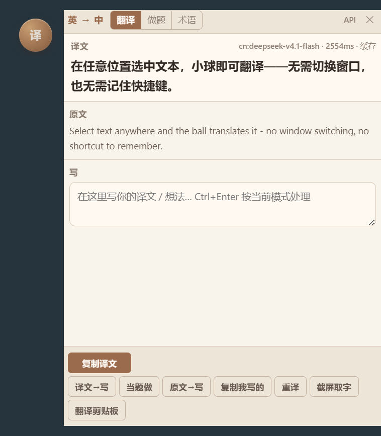
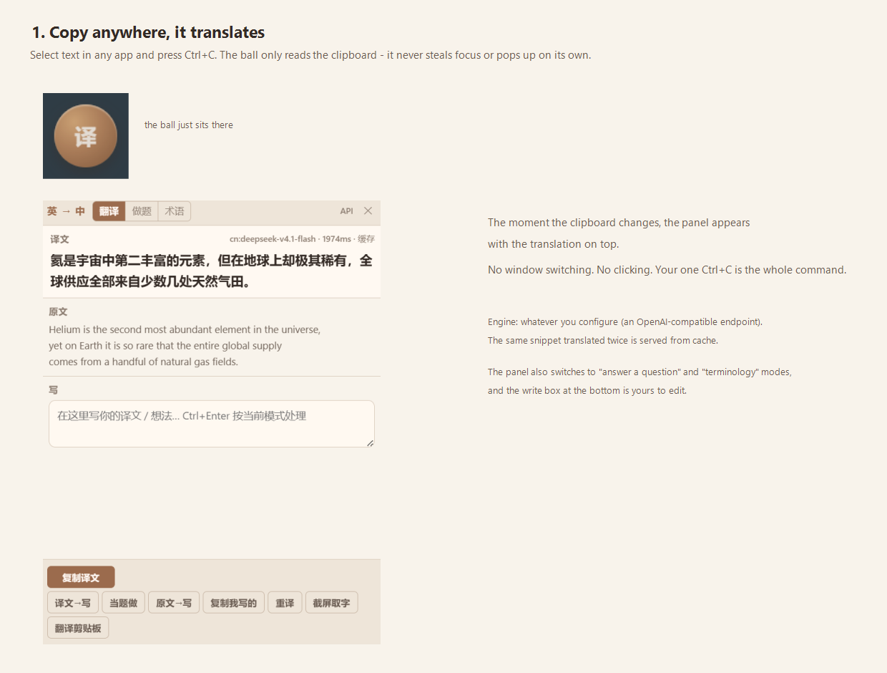
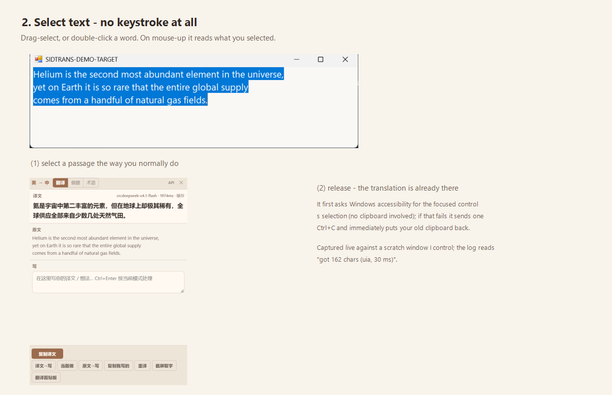
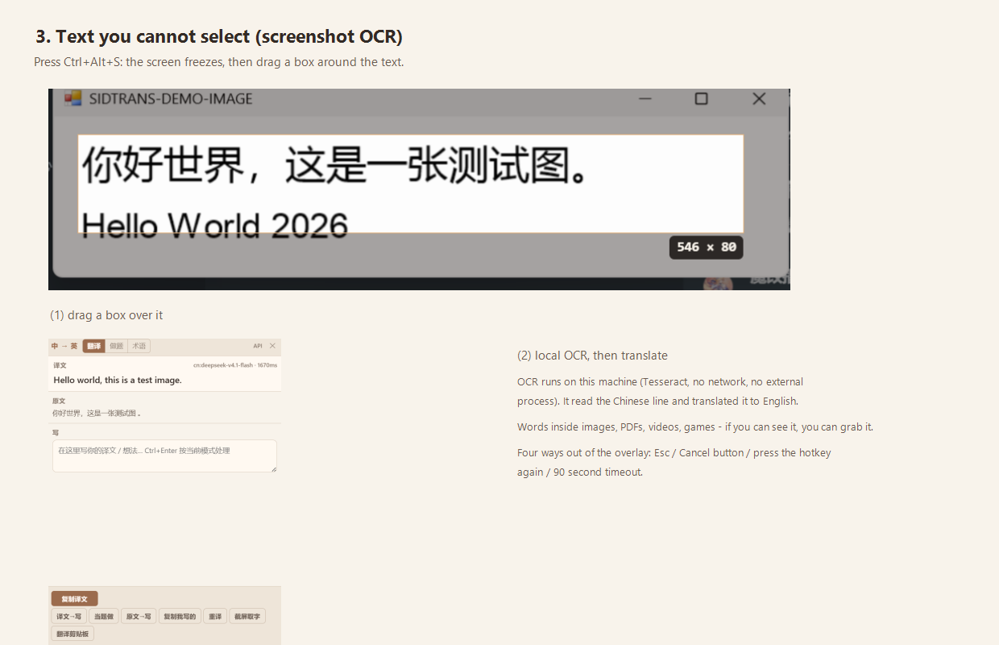

# SideTrans Desktop

A floating ball for Windows that translates whatever you **select**, **copy**, or **screenshot** —
without switching windows, and without remembering a shortcut.



> **The interaction idea comes from [FlashTrans](https://github.com/chai1220/FlashTrans) (chai1220, MIT)** —
> a desktop translation tool written in Tauri + Rust, where the popup lands next to your selection and
> never interrupts what you are doing. This is a desktop (Electron) implementation built on that idea.
> It contains **no FlashTrans code**. See [THIRD-PARTY.md](THIRD-PARTY.md).

---

## Three ways in

| | How you trigger it | What it's for |
|---|---|---|
| **Select** | drag-select, or double-click a word | reading anything on screen — no keystroke at all |
| **Copy** | `Ctrl+C` in any app | when you'd rather keep your hands on the keyboard |
| **Screenshot** | `Ctrl+Alt+S`, then drag a box | text you *cannot* select: images, PDFs, videos, games |

### 1. Copy anywhere



### 2. Select text — no keystroke



### 3. Text you cannot select



A short clip of it working (recorded frame-by-frame on a real machine, not drawn):


---

## What it deliberately cannot do

- **Games and video players are out of reach.** The ball can read a selection through Windows
  accessibility, and it can send one `Ctrl+C`. A rendered game surface offers neither — there is no
  "selected text" to read. It says so plainly instead of pretending.
- **No per-app injection, no global hooks into other processes.** Only Windows' own APIs are used:
  UI Automation for reading a selection, a synthetic copy keystroke as fallback, and a small mouse
  watcher to know when a selection gesture ended.
- **No silent uploads.** OCR runs entirely on your machine (Tesseract compiled to WASM). Only the
  final text goes to the translation engine you configured.

---

## Install

**Download the portable exe from [Releases](../../releases)** and double-click it. No installer, no admin
rights. It unpacks itself and starts.

> ⚠️ **Keep it on an ASCII-only path** (e.g. `C:\Apps\SideTrans\`). Electron cannot start when its own
> executable sits under a non-ASCII path — it dies while loading its resources, before a single line of
> JavaScript runs. This was the single most confusing bug in this project.

The first launch asks nothing. Translation works out of the box with a free online engine; for real
quality, point it at any OpenAI-compatible endpoint. Settings live in the tray menu (right-click the
tray icon).

## Run from source

```powershell
# in the folder that has package.json
npm install          # Electron + Tesseract
# if npm's script policy blocks Electron's binary download:
#   $env:ELECTRON_MIRROR="https://npmmirror.com/mirrors/electron/"; node node_modules\electron\install.js
npm run vendor       # move the OCR runtime from node_modules into vendor/ (a few tens of MB, not in git)
npm start
```

On Windows, `启动桌面版.cmd` in the project root does the same thing and also copies the Electron
runtime to `%LOCALAPPDATA%\Programs\sidtrans-desktop\electron\` — the ASCII path workaround described
above.

## Self-checks

Five layers; every one of them is a command you can run yourself.

```powershell
npm run selftest           # logic: syntax, file references, engine fallbacks, clipboard gate, cache keys, geometry
node test\ocr_engine.mjs   # OCR: actually runs Tesseract on a Chinese and an English image
node test\render_check.mjs # UI: runs the real orb/panel pages in headless Edge and asserts the rendered state
npm run smoke              # the whole app in real Electron: windows, tray, clipboard, overlay, OCR, picker
node test\pick_check.mjs   # the picker: reads a selection in a foreign process, and never dirties your clipboard
```

The overlay and the pick helper carry their own regression tests — both of them once cost real time:
the overlay could not be dismissed at all (a one-line CSS-less bug: a variable name collided with a
global, so the page's script never ran), and the picker reported success while reading nothing.

## Privacy

- The ball **only reads** the clipboard. The one place it writes is the "copy translation" button —
  and it remembers that write so it does not translate its own output back at you.
- Anything that looks like a key or a token is **not** translated; you get a short note instead.
- OCR is local. Logs record *which step failed* and how many characters — **never what you were
  translating**. Settings (including your API key) stay in `%APPDATA%\sidtrans-desktop\`.

## Built with

FlashTrans (interaction idea, MIT) · [Tesseract.js](https://github.com/naptha/tesseract.js) (Apache-2.0)
· [Electron](https://github.com/electron/electron) (MIT). Full list in [THIRD-PARTY.md](THIRD-PARTY.md).

MIT — see [LICENSE](LICENSE).
